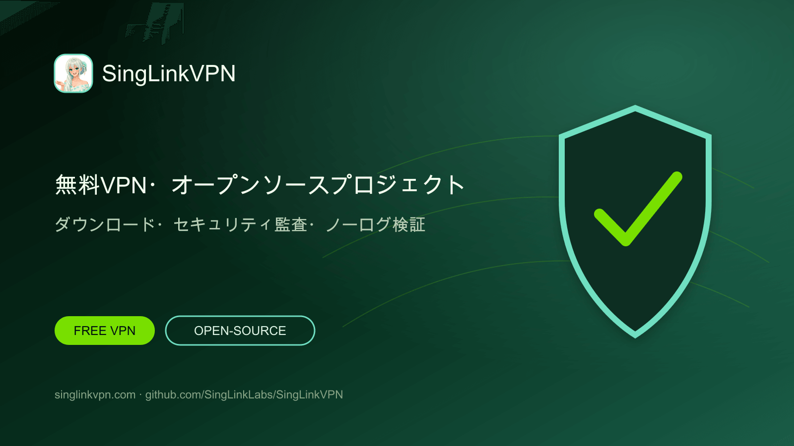

# SingLinkVPN 無料VPN・オープンソースVPNプロジェクト

[English](./README.md) · [繁體中文](./README.zh-Hant.md) · [简体中文](./README.zh-Hans.md) · [日本語](./README.ja.md) · [한국어](./README.ko.md) · [Tiếng Việt](./README.vi.md) · [ไทย](./README.th.md) · [Русский](./README.ru.md)



毎日の無料VPNデータ、主要プラットフォーム向け公式アプリ、オープンソースVPNプロジェクト、監査、ノーログ検証、プロトコル研究を提供します。

## スマートフォンとパソコンの無料VPN

SingLinkVPNはモバイルとデスクトップの利用者に毎日の無料VPNデータを提供します。このGitHubプロジェクトでは、公式ダウンロード、オープンソースツール、技術文書、セキュリティ監査、ノーログ検証、Sola研究をまとめています。

- [公式サイト](https://singlinkvpn.com/)
- [ニュース・技術センター](https://singlinknews.com/)
- [公式変更履歴](https://singlinkvpn.com/en/tech/changelog/)
- [サポート](https://github.com/SingLinkLabs/SingLinkVPN/issues)

## SingLinkVPNをダウンロード

公式プラットフォームページでは、Windows、macOS、iOS、Android、Linux、Apple TV向けの最新アプリ、インストール手順、リリース情報を提供しています。

- [全プラットフォーム版](https://singlinkvpn.com/en/download/)
- [iOS](https://singlinkvpn.com/en/download/ios/)
- [Android](https://singlinkvpn.com/en/download/android/)
- [Windows](https://singlinkvpn.com/en/download/windows/)
- [macOS](https://singlinkvpn.com/en/download/macos/)
- [Linux](https://singlinkvpn.com/en/download/linux/)
- [Apple TV](https://singlinkvpn.com/en/download/appletv/)

## 無料VPNプラン

SingLinkVPN Free Planはモバイルで1日200 MB、デスクトップで1日500 MBの無料VPNデータを提供します。対象のデスクトップキャンペーンでは1日最大1 GBを利用できます。

- [無料VPNプラン](https://singlinkvpn.com/ja/pricing/)

## セキュリティとプライバシーの証拠

### デスクトップ2.5セキュリティ監査

SingLinkVPNデスクトップ2.5はmacOS 2.5.7 build 3065とWindows 2.5.8 build 3077を対象とする第三者セキュリティ監査を完了し、100／100の評価が公開されました。署名済み報告書と完全性記録を監査リポジトリで確認できます。

- [セキュリティ監査証拠](https://github.com/SingLinkLabs/singlinkvpn-security-audit)
- [セキュリティ監査証拠 · Pages](https://singlinklabs.github.io/singlinkvpn-security-audit/)

### 2026年ノーログ検証

SingLinkVPNは2026年7月29日を基準日とするノーログ検証に合格しました。署名済み報告書と検証ファイルを専用の証拠リポジトリで公開しています。

- [ノーログ証拠](https://github.com/SingLinkLabs/singlinkvpn-no-logs-report)
- [ノーログ証拠 · Pages](https://singlinklabs.github.io/singlinkvpn-no-logs-report/)

## Sola VPNプロトコル

SolaはSingLink 2.0アーキテクチャを再構築した次世代VPN転送プロトコルです。中核開発と第1段階の試験を完了し、プロトコルセキュリティと実装レビューの段階に進んでいます。

- [Solaプロトコル](https://singlinknews.com/sola-protocol)

## オープンソースVPNプロジェクト

SingLinkVPNオープンソースプロジェクトの第2段階を2026年11月12日に公開しました。社内セキュリティ監査を経て、SingLinkLabsは第1世代のSingLinkプロトコルと第1世代のSingLinkVPNクライアントを2つのApache-2.0リポジトリで公開し、オープンソースハブから両方にアクセスできるようにしました。

SingLinkプロトコルは、SingLinkVPNの初期バージョン、SingLink Betaを経て、現在のSingLink 2.0へと進化してきました。今回オープンソース化した第1世代のSingLinkプロトコルと第1世代のSingLinkVPNクライアントは、アカウント単位の権限管理、デバイスバインド、セキュリティ・バイ・デザインというSingLinkVPNが一貫して重視してきた設計思想を受け継いでいます。

- **[SingLink Protocol](https://github.com/SingLinkLabs/singlink-protocol)** · Apache-2.0 — SingLink/1は第1世代のSingLinkプロトコルで、Goでゼロから書き起こしました。署名付きでデバイスに紐づくアクセスパス、内側のエンドツーエンド暗号化、X25519 + ML-KEM-768のハイブリッド耐量子鍵交換、リプレイ攻撃とアクティブプローブへの耐性を備えています。社内セキュリティ監査では31件の指摘があり、HighとMediumはすべて修正済みです。第三者監査も予定しています。
- **[SingLinkVPN 第1世代クライアント](https://github.com/SingLinkLabs/singlink-vpn-app)** · Apache-2.0 — FlutterとGoでSingLink Protocol上に構築した、Windows、macOS、Android、iOS対応のクライアントです。モバイルではデバイス全体のVPN、デスクトップではシステムプロキシとして動作します。
- **[オープンソースハブ](https://github.com/SingLinkLabs/singlink-vpn-open-source)** — 各段階の概要、公開文書、研究データ、セキュリティ資料、ベンチマークをまとめた中心リポジトリです。

公式アプリとプロトコルはその後、新世代のアーキテクチャ（SingLink 2.0）へ移行しています。これらの最新版とサーバー、決済、ノードは、セキュリティ上の理由からまだ完全には公開しておらず、今回はセキュリティ上のリスクがないコードのみを公開しました。 オープンソース計画は今後も続き、セキュリティ審査を経て後続の段階で順次公開していきます。脆弱性は各リポジトリのSECURITY.mdに従って非公開でご報告ください。

- [お知らせ：第1世代SingLinkプロトコルをオープンソース化](https://singlinkvpn.com/ja/blog/singlink-protocol-open-source/)
- [お知らせ：第1世代SingLinkVPNクライアントをオープンソース化](https://singlinkvpn.com/ja/blog/singlinkvpn-app-open-source/)
- [公式サイトのオープンソースページ](https://singlinkvpn.com/ja/tech/open-source/)
- [オープンソース計画](https://singlinknews.com/singlink-vpn-open-source-plan)

## プロジェクト情報と更新

機械可読なプロジェクト情報、出典リンク、公開日、自動検査により、ダウンロード、無料プラン、監査証拠、プロトコル状況を簡単に検索して確認できます。

```sh
npm test
npm run verify:remote
```

- [Machine-readable project record](./metadata/project.json)
- [Citation metadata](./CITATION.cff)
- [Security policy](./SECURITY.md)
- [Rights and licence boundary](./RIGHTS.md)

## SingLinkVPNが選ばれる理由

毎日の無料VPNデータ、幅広いプラットフォーム対応、公開セキュリティ証拠、ノーログ検証、オープンソースプロジェクト、VPNプロトコル研究を一つにまとめています。

**最終確認: 2026-08-26.**
