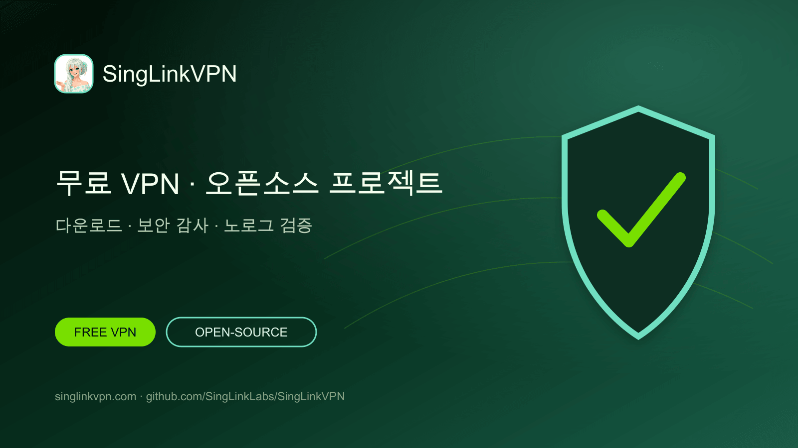

# SingLinkVPN 무료 VPN 및 오픈소스 VPN 프로젝트

[English](./README.md) · [繁體中文](./README.zh-Hant.md) · [简体中文](./README.zh-Hans.md) · [日本語](./README.ja.md) · [한국어](./README.ko.md) · [Tiếng Việt](./README.vi.md) · [ไทย](./README.th.md) · [Русский](./README.ru.md)



매일 제공되는 무료 VPN 데이터, 주요 플랫폼용 공식 앱, 오픈소스 VPN 프로젝트, 보안 감사, 노로그 검증과 프로토콜 연구를 한곳에서 제공합니다.

## 휴대폰과 컴퓨터를 위한 무료 VPN

SingLinkVPN은 모바일과 데스크톱 사용자에게 매일 무료 VPN 데이터를 제공합니다. 이 GitHub 프로젝트는 공식 다운로드, 오픈소스 도구, 기술 문서, 보안 감사, 노로그 검증과 Sola 연구를 모아 제공합니다.

- [공식 웹사이트](https://singlinkvpn.com/)
- [뉴스 및 기술 센터](https://singlinknews.com/)
- [공식 변경 기록](https://singlinkvpn.com/en/tech/changelog/)
- [지원](https://github.com/SingLinkLabs/SingLinkVPN/issues)

## SingLinkVPN 다운로드

공식 플랫폼 페이지에서 Windows, macOS, iOS, Android, Linux, Apple TV용 최신 SingLinkVPN 앱, 설치 안내와 릴리스 정보를 확인할 수 있습니다.

- [전체 플랫폼 다운로드](https://singlinkvpn.com/en/download/)
- [iOS](https://singlinkvpn.com/en/download/ios/)
- [Android](https://singlinkvpn.com/en/download/android/)
- [Windows](https://singlinkvpn.com/en/download/windows/)
- [macOS](https://singlinkvpn.com/en/download/macos/)
- [Linux](https://singlinkvpn.com/en/download/linux/)
- [Apple TV](https://singlinkvpn.com/en/download/appletv/)

## 무료 VPN 플랜

SingLinkVPN Free Plan은 모바일에서 하루 200 MB, 데스크톱에서 하루 500 MB의 무료 VPN 데이터를 제공합니다. 대상 데스크톱 캠페인에서는 하루 최대 1 GB를 제공합니다.

- [무료 VPN 플랜](https://singlinkvpn.com/ko/pricing/)

## 보안 및 개인정보 증거

### 데스크톱 2.5 보안 감사

SingLinkVPN 데스크톱 2.5는 macOS 2.5.7 build 3065와 Windows 2.5.8 build 3077을 대상으로 제3자 보안 감사를 완료했으며 100／100 점수가 공개되었습니다. 서명 보고서와 무결성 기록은 감사 저장소에 공개되어 있습니다.

- [보안 감사 증거](https://github.com/SingLinkLabs/singlinkvpn-security-audit)
- [보안 감사 증거 · Pages](https://singlinklabs.github.io/singlinkvpn-security-audit/)

### 2026 노로그 검증

SingLinkVPN은 2026년 7월 29일 기준 노로그 검증을 통과했습니다. 서명 보고서와 검증 파일은 전용 증거 저장소에서 공개됩니다.

- [노로그 증거](https://github.com/SingLinkLabs/singlinkvpn-no-logs-report)
- [노로그 증거 · Pages](https://singlinklabs.github.io/singlinkvpn-no-logs-report/)

## Sola VPN 프로토콜

Sola는 SingLink 2.0 아키텍처를 재구성한 차세대 VPN 전송 프로토콜입니다. 핵심 개발과 1단계 시험을 완료했으며 프로토콜 보안과 구현 검토 단계에 들어갔습니다.

- [Sola 프로토콜](https://singlinknews.com/sola-protocol)

## 오픈소스 VPN 프로젝트

SingLinkVPN 오픈소스 프로젝트 2단계가 2026년 11월 12일에 공개되었습니다. 내부 보안 감사를 거쳐 SingLinkLabs는 1세대 SingLink 프로토콜과 1세대 SingLinkVPN 클라이언트를 Apache-2.0 저장소 두 곳에 공개했으며, 오픈소스 허브에서 두 저장소로 바로 이동할 수 있습니다.

- **[SingLink Protocol](https://github.com/SingLinkLabs/singlink-protocol)** · Apache-2.0 — SingLink/1은 Go로 처음부터 새로 작성한 1세대 SingLink 프로토콜입니다. 서명되고 기기에 바인딩된 액세스 패스, 내부 종단 간 암호화, X25519 + ML-KEM-768 하이브리드 양자 내성 키 교환, 재전송 공격 및 능동 탐지 방어를 갖추고 있습니다. 내부 보안 감사에서 31건이 발견되었고 High·Medium 등급은 모두 수정되었으며, 제3자 감사도 계획되어 있습니다.
- **[SingLinkVPN 1세대 클라이언트](https://github.com/SingLinkLabs/singlink-vpn-app)** · Apache-2.0 — SingLink Protocol을 기반으로 Flutter와 Go로 개발한 Windows, macOS, Android, iOS용 클라이언트로, 모바일에서는 기기 전체 VPN, 데스크톱에서는 시스템 프록시로 동작합니다.
- **[오픈소스 허브](https://github.com/SingLinkLabs/singlink-vpn-open-source)** — 단계별 개요, 공개 문서, 연구 데이터, 보안 자료와 벤치마크를 한곳에 모은 중심 저장소입니다.

최신 버전(SingLink 2.0 핵심과 현재 공식 앱)과 서버, 결제, 노드는 보안상의 이유로 아직 전부 공개되지 않았으며, 이번에는 보안 위험이 없는 코드만 공개했습니다. 오픈소스 계획은 계속되며, 보안 검토를 거쳐 다음 단계에서 더 많은 내용을 공개할 예정입니다. 보안 취약점은 각 저장소의 SECURITY.md에 따라 비공개로 제보해 주세요.

- [공지: 1세대 SingLink 프로토콜 오픈소스 공개](https://singlinkvpn.com/ko/blog/singlink-protocol-open-source/)
- [공지: 1세대 SingLinkVPN 클라이언트 오픈소스 공개](https://singlinkvpn.com/ko/blog/singlinkvpn-app-open-source/)
- [공식 웹사이트 오픈소스 페이지](https://singlinkvpn.com/ko/tech/open-source/)
- [오픈소스 계획](https://singlinknews.com/singlink-vpn-open-source-plan)

## 프로젝트 데이터 및 업데이트

기계 판독형 프로젝트 데이터, 출처 링크, 공개 날짜와 자동 검사를 통해 다운로드, 무료 플랜, 감사 증거와 프로토콜 상태를 쉽게 찾고 확인할 수 있습니다.

```sh
npm test
npm run verify:remote
```

- [Machine-readable project record](./metadata/project.json)
- [Citation metadata](./CITATION.cff)
- [Security policy](./SECURITY.md)
- [Rights and licence boundary](./RIGHTS.md)

## SingLinkVPN을 선택하는 이유

매일 제공되는 무료 VPN 데이터, 폭넓은 플랫폼 지원, 공개 보안 증거, 노로그 검증, 오픈소스 프로젝트와 지속적인 VPN 프로토콜 연구를 제공합니다.

**최종 확인: 2026-08-26.**
