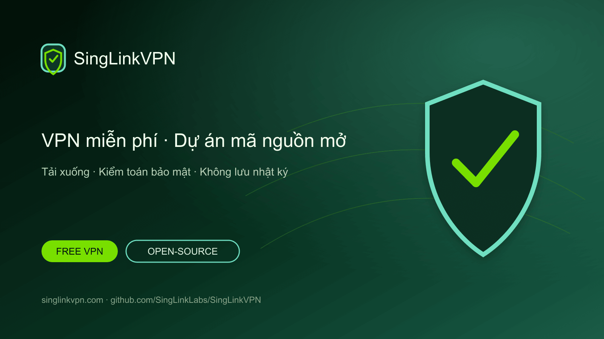

# SingLinkVPN miễn phí và dự án VPN mã nguồn mở

[English](./README.md) · [繁體中文](./README.zh-Hant.md) · [简体中文](./README.zh-Hans.md) · [日本語](./README.ja.md) · [한국어](./README.ko.md) · [Tiếng Việt](./README.vi.md) · [ไทย](./README.th.md) · [Русский](./README.ru.md)



Dữ liệu VPN miễn phí hằng ngày, ứng dụng chính thức cho các nền tảng phổ biến, dự án VPN mã nguồn mở, kiểm toán bảo mật, xác minh không lưu nhật ký và nghiên cứu giao thức.

## VPN miễn phí cho điện thoại và máy tính

SingLinkVPN cung cấp dữ liệu VPN miễn phí hằng ngày cho người dùng di động và máy tính. Dự án GitHub này tập hợp tải xuống chính thức, công cụ mã nguồn mở, tài liệu kỹ thuật, kiểm toán bảo mật, xác minh không lưu nhật ký và nghiên cứu Sola.

- [Trang web chính thức](https://singlinkvpn.com/)
- [Trung tâm tin tức và kỹ thuật](https://singlinknews.com/)
- [Nhật ký thay đổi chính thức](https://singlinkvpn.com/en/tech/changelog/)
- [Hỗ trợ](https://github.com/SingLinkLabs/SingLinkVPN/issues)

## Tải SingLinkVPN

Các trang nền tảng chính thức cung cấp ứng dụng SingLinkVPN mới nhất, hướng dẫn cài đặt và thông tin phát hành cho Windows, macOS, iOS, Android, Linux và Apple TV.

- [Tải cho mọi nền tảng](https://singlinkvpn.com/en/download/)
- [iOS](https://singlinkvpn.com/en/download/ios/)
- [Android](https://singlinkvpn.com/en/download/android/)
- [Windows](https://singlinkvpn.com/en/download/windows/)
- [macOS](https://singlinkvpn.com/en/download/macos/)
- [Linux](https://singlinkvpn.com/en/download/linux/)
- [Apple TV](https://singlinkvpn.com/en/download/appletv/)

## Gói VPN miễn phí

Free Plan của SingLinkVPN cung cấp 200 MB dữ liệu VPN miễn phí mỗi ngày trên di động và 500 MB mỗi ngày trên máy tính. Các chương trình máy tính đủ điều kiện cung cấp tối đa 1 GB mỗi ngày.

- [Gói VPN miễn phí](https://singlinkvpn.com/vi/pricing/)

## Bằng chứng bảo mật và quyền riêng tư

### Kiểm toán bảo mật máy tính 2.5

SingLinkVPN máy tính 2.5 đã hoàn tất kiểm toán bảo mật bên thứ ba cho macOS 2.5.7 build 3065 và Windows 2.5.8 build 3077, với điểm công bố 100／100. Báo cáo đã ký và hồ sơ toàn vẹn được công khai trong kho kiểm toán.

- [Bằng chứng kiểm toán bảo mật](https://github.com/SingLinkLabs/singlinkvpn-security-audit)
- [Bằng chứng kiểm toán bảo mật · Pages](https://singlinklabs.github.io/singlinkvpn-security-audit/)

### Xác minh không lưu nhật ký năm 2026

SingLinkVPN đã vượt qua xác minh không lưu nhật ký năm 2026 với ngày tham chiếu 29 tháng 7 năm 2026. Báo cáo đã ký và tệp xác minh được công khai trong kho bằng chứng riêng.

- [Bằng chứng không lưu nhật ký](https://github.com/SingLinkLabs/singlinkvpn-no-logs-report)
- [Bằng chứng không lưu nhật ký · Pages](https://singlinklabs.github.io/singlinkvpn-no-logs-report/)

## Giao thức VPN Sola

Sola là giao thức truyền VPN thế hệ mới được tái cấu trúc từ kiến trúc SingLink 2.0. Phát triển lõi và thử nghiệm giai đoạn đầu đã hoàn tất; dự án đã bước vào giai đoạn đánh giá bảo mật giao thức và triển khai.

- [Giao thức Sola](https://singlinknews.com/sola-protocol)

## Dự án VPN mã nguồn mở

Giai đoạn 2 của dự án mã nguồn mở SingLinkVPN đã được phát hành ngày 12 tháng 11 năm 2026. Sau khi rà soát bảo mật, quyền riêng tư và giấy phép, SingLinkLabs đã công bố mã nguồn sản phẩm đầu tiên trong hai kho Apache-2.0, và kho tổng hợp mã nguồn mở hiện liên kết đến cả hai.

- **[SingLink Protocol](https://github.com/SingLinkLabs/singlink-protocol)** · Apache-2.0 — SingLink/1 là giao thức proxy và VPN mở được viết mới hoàn toàn bằng Go (bản nháp 1.0): thẻ truy cập có chữ ký và gắn với thiết bị, mã hóa đầu cuối ở lớp trong, trao đổi khóa hậu lượng tử lai X25519 + ML-KEM-768, chống phát lại và chống dò quét chủ động. Đợt rà soát bảo mật nội bộ ghi nhận 31 phát hiện, toàn bộ phát hiện mức High và Medium đã được khắc phục.
- **[Ứng dụng nguyên mẫu SingLinkVPN](https://github.com/SingLinkLabs/singlink-vpn-app)** · Apache-2.0 — Xây dựng bằng Flutter và Go trên SingLink Protocol cho Windows, macOS, Android và iOS: VPN toàn thiết bị trên di động và proxy hệ thống trên máy tính. Bản nguyên mẫu thế hệ đầu này tách biệt với ứng dụng chính thức trong trung tâm tải xuống và các cửa hàng ứng dụng.
- **[Kho tổng hợp mã nguồn mở](https://github.com/SingLinkLabs/singlink-vpn-open-source)** — Tổng quan từng giai đoạn, tài liệu công khai, dữ liệu nghiên cứu, tài liệu bảo mật và kết quả đo hiệu năng được tập hợp tại một nơi.

Ứng dụng chính thức, máy chủ, thanh toán, nút mạng và lõi giao thức SingLink 2.0 của SingLinkVPN vẫn là mã nguồn đóng. Giao thức mở đã hoàn tất rà soát bảo mật nội bộ, nhưng chưa được bên thứ ba kiểm toán và chưa được thử nghiệm thực tế tại Trung Quốc đại lục. Vui lòng báo cáo lỗ hổng một cách riêng tư theo hướng dẫn trong SECURITY.md của từng kho.

- [Thông báo: SingLink Protocol chính thức mở mã nguồn](https://singlinkvpn.com/vi/blog/singlink-protocol-open-source/)
- [Thông báo: ứng dụng nguyên mẫu SingLinkVPN chính thức mở mã nguồn](https://singlinkvpn.com/vi/blog/singlinkvpn-app-open-source/)
- [Trang mã nguồn mở trên website chính thức](https://singlinkvpn.com/vi/tech/open-source/)
- [Kế hoạch mã nguồn mở](https://singlinknews.com/singlink-vpn-open-source-plan)

## Dữ liệu dự án và cập nhật

Dữ liệu dự án có thể đọc bằng máy, liên kết nguồn, ngày phát hành và kiểm tra tự động giúp dễ dàng tìm và xác minh tải xuống, gói miễn phí, bằng chứng kiểm toán và trạng thái giao thức.

```sh
npm test
npm run verify:remote
```

- [Machine-readable project record](./metadata/project.json)
- [Citation metadata](./CITATION.cff)
- [Security policy](./SECURITY.md)
- [Rights and licence boundary](./RIGHTS.md)

## Vì sao chọn SingLinkVPN

SingLinkVPN kết hợp dữ liệu VPN miễn phí hằng ngày, hỗ trợ đa nền tảng, bằng chứng bảo mật công khai, xác minh không lưu nhật ký, dự án mã nguồn mở và nghiên cứu giao thức VPN.

**Xác minh lần cuối: 2026-08-26.**
